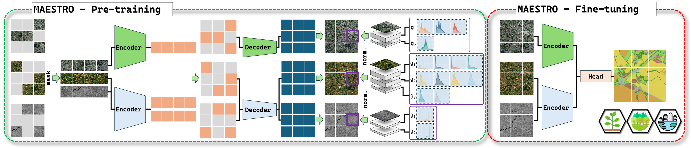

# MAESTRO: Masked AutoEncoders for Multimodal, Multitemporal, and Multispectral Earth Observation Data

## Description
### Abstract
We introduce **MAESTRO**, a tailored adaptation of the Masked Autoencoder (MAE) framework which effectively orchestrates the use of multimodal, multitemporal, and multispectral EO data—both in terms of performance and computational cost.
Evaluated on four diverse EO datasets, MAESTRO consistently achieves state-of-the-art performance across the different benchmarks.



### Features

- **Extensive Benchmarking:** Impact evaluation of various fusion strategies for multimodal and multitemporal SSL.
- **Patch-spectral-wise normalization:** Novel normalization method that normalizes reconstruction targets patch-wise within groups of highly correlated spectral bands.
- **MAESTRO Method:** Novel adaptation of the MAE that combines optimized fusion strategies with a target normalization scheme that introduces an effective multispectral prior as self-supervisory signal to learn better deep representation.


### Results
<div align="center">

| Item            | TreeSatAI-TS | PASTIS-HD | FLAIR#2 | FLAIR-HUB |
|-----------------|:------------:|----------:|--------:|----------:|
| MAESTRO         |      0       |         0 |       0 |         0 |
| DINO-v2         |      0       |         0 |       0 |         0 |
| DINO-v2 sat.    |      0       |         0 |       0 |         0 |
| DOFA            |      0       |         0 |       0 |         0 |
| CROMA           |      0       |         0 |       0 |         0 |
| AnySat          |      0       |         0 |       0 |         0 |
|            |              |           |         |          |
| ViT             |      0       |         0 |       0 |         0 |
|          |              |           |         |          |
| Previous SOTA   |      0       |         0 |       0 |         0 |

</div>

## Getting Started
```bash
    # 1. Clone the repository

    git clone https://github.com/your-org/ssl-models.git
    cd ssl-models

    # 2. Install dependencies with Poetry
    poetry install
```

### Run Locally
To run the model locally, you can use the following minimal code:
```bash
poetry run python main.py \
        model.model=mae \
        model.model_size=medium \
        model.use_ema=True \
        run.exp_name=mae-m_pastis \
        run.exp_dir=/path/to/experiments/dir \
        datasets.root_dir=/path/to/dataset/dir \
        datasets.pastis_hd.rel_dir=PASTIS-HD \
        datasets.filter_pretrain=[pastis_hd] \
        datasets.filter_finetune=[pastis_hd]

```
Many parameters can be modified with the hydra configuration.

### Data
Our implementation already supports 4 datasets:  

**TreeSatAI-TS**  
Tree species identification, with 15 multi-label classes.
  - Extent: 50,381 tiles of 60 × 60 m in Germany.
  - Modalities: aerial imagery RGB + NIR (0.2 m), Sentinel-1 time series, Sentinel-2 time series.

**PASTIS-HD**  
Agricultural crop segmentation, with 19 semantic classes. 
  - Extent:433 tiles of 1280 × 1280 m in France.
  - Modalities: VHR satellite imagery SPOT 6-7 (1 m), Sentinel-1 time series, Sentinel-2 time series.

**FLAIR#2**  
Land cover segmentation, with 12 semantic classes.
  - Extent: 77,762 tiles of 102.4×102.4 m in France.
  - Modalities: Aarial and elevation imagery RGB + NIR + DSM (0.2 m), Sentinel-2 time series.

**FLAIR-HUB**  
Land cover segmentation, with 15 semantic classes.
  - Extent: 241,100 tiles of 102.4 × 102.4 m in France.
  - Modalities: Aerial and elevation imagery RGB + NIR + DEM +
DSM (0.2 m), Sentinel-1 time series, Sentinel-2 time series.


## Contact

For questions or contributions, please open an issue or contact the authors.
 